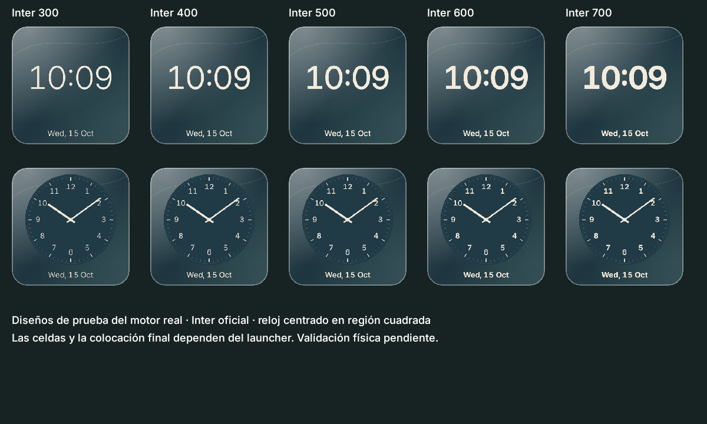
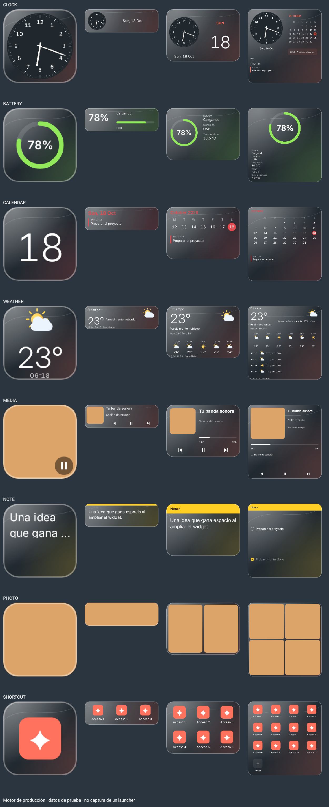
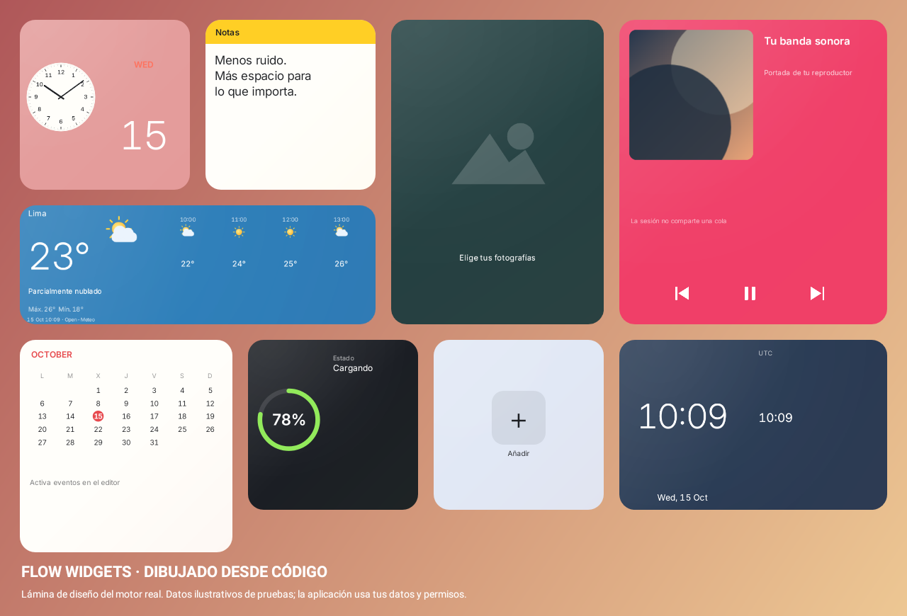

# Flow Widgets

Aplicación Android nativa para personalizar la pantalla de inicio con ocho tipos de widgets reales. Kotlin, Jetpack Compose, Material 3, RemoteViews, DataStore, Coroutines y WorkManager. Sin anuncios, cuentas, rastreadores, root ni modificaciones del launcher.

**Paquete:** `com.flowwidgets.app` · **Android:** 13–16 (API mínima 33, target/compile 36).

## Correcciones e Inter · 1.2.1

Se conserva el estilo y los colores elegidos desde la primera colocación, incluso si el launcher actualiza antes de confirmar. El reloj compacto usa una esfera cuadrada y centrada. Inter oficial es la fuente predeterminada, con cinco pesos seleccionables, números tabulares y ajuste al espacio disponible, también en TextClock del escritorio.



[Fuente, licencia, correcciones y límites](docs/TYPOGRAPHY.md). Instala sobre la versión anterior. Para los widgets que ya quedaron con ajustes por defecto, abre **Mis widgets → Editar** y guarda el diseño deseado; la versión anterior no conservó esa selección en la instancia afectada.

## Widgets adaptativos · 1.2

El mismo widget cambia su composición al redimensionarlo desde el escritorio: aparecen más detalles, controles, collages y accesos. El editor permite simular once proporciones, configurar zonas horarias, listas de tareas, varios accesos y Soft Light Glass. Los ajustes se conservan por instancia.



Ejemplo generado con datos exclusivos de pruebas; no es una captura de HyperOS. Consulta [arquitectura, estrategias, APIs y límites](docs/ADAPTIVE_WIDGETS.md).

## Nuevo diseño visual · 1.1

Los widgets del escritorio ahora usan un motor gráfico original (`VisualWidgetRenderer`) compartido con las vistas previas de Compose. Las esferas, agujas, iconos del clima, anillos de batería, papel de notas y controles se dibujan desde código. Las fotos y portadas provienen únicamente de tu selección o sesión multimedia. No hacen falta assets de Apple ni fuentes propietarias.



La lámina usa datos ilustrativos de las pruebas, no datos introducidos en la aplicación. El widget real consulta el dispositivo y muestra estados vacíos cuando faltan datos o permisos. Los relojes de escritorio siguen siendo TextClock/AnalogClock nativos: las agujas no son una imagen de hora congelada. Los controles multimedia permanecen como acciones nativas sobre la composición dibujada.

Instala el APK sobre la versión anterior para conservar tus ajustes. Un reloj existente configurado como digital seguirá siendo digital: activa **Reloj analógico** en su editor para ver la nueva esfera. Si el launcher conserva una vista vieja después de actualizar, quita ese widget y vuelve a añadirlo. Las nuevas instancias de reloj comienzan en modo analógico.

Las vistas del selector de widgets también se generan con el mismo código; muestran guiones o instrucciones cuando no hay un dato real. Android sigue decidiendo la cuadrícula final. La apertura y la apariencia en HyperOS requieren comprobación física.

## Compilar e instalar

Requisitos: JDK 21, Android SDK API 36, Build Tools 36.0.0. El wrapper fija Gradle 8.13 y verifica SHA-256; Android Gradle Plugin 8.13.0 y Kotlin 2.1.20.

```bash
# Solo en el entorno cloud preparado para este proyecto:
source /workspace/toolchains/activate.sh
cd /workspace/FlowWidgets
./gradlew assembleDebug
./gradlew testDebugUnitTest lintDebug

# Dispositivo conectado con depuración USB habilitada:
adb install -r app/build/outputs/apk/debug/app-debug.apk
```

Fuera del entorno cloud, configurar `JAVA_HOME` y `ANDROID_HOME` o `sdk.dir` en un archivo local `local.properties` (ignorado por Git). Se necesita acceso HTTPS a Google Maven, Maven Central y las distribuciones Gradle durante la primera compilación. No guardar claves, contraseñas ni rutas personales en archivos versionados.

El entregable de depuración se copia a **`dist/FlowWidgets-debug.apk`**. Es una compilación de desarrollo firmada con una clave de depuración; no es una publicación en Play Store.

## Uso

1. Abre Flow Widgets y explora las categorías.
2. Selecciona un widget. Elige Classic, One Style, Glass o Material; cambia colores, fuente, escala de texto y tamaño recomendado.
3. Configura los datos que necesite y pulsa **Añadir a la pantalla de inicio**. Confirma el diálogo del launcher.
4. Si el launcher no admite fijado directo, mantén pulsado el escritorio, abre Widgets y elige Flow Widgets. La pantalla de configuración permite guardar o cancelar.
5. Redimensiona desde el launcher. Edita las instancias en **Mis widgets**; elimina del escritorio con las herramientas del propio launcher.

La configuración se conserva por `appWidgetId`, incluidas dos instancias del mismo tipo. Restablecer recupera los ajustes de esa instancia. El selector de tamaño es orientativo: el launcher controla las celdas y el espacio real. Se admiten redimensionamientos horizontales y verticales para composiciones 1×1, 1×2, 2×1, 2×2, 3×1, 3×2, 2×3, 4×1, 4×2, 2×4 y 4×4; no se garantiza una cuadrícula exacta en HyperOS sin comprobarla en la tablet.

## Funciones

| Widget | Datos y comportamiento |
| --- | --- |
| Reloj | TextClock/AnalogClock del sistema, formato 12/24 h, fecha, segundero digital opcional dependiente del host. No hay un servicio actualizando cada segundo. |
| Batería | Nivel y estado de carga reales, indicador circular y horizontal; sin estimaciones inventadas de autonomía. |
| Calendario | Fecha y mes actuales, día destacado, inicio de semana configurable. Los próximos eventos requieren permiso opcional de calendario. |
| Clima | Ciudad elegida mediante búsqueda; temperatura, estado, máximas/mínimas y horas desde Open-Meteo. Caché local y hora de actualización visibles. |
| Multimedia | Sesión activa oficial de Android, título, artista, portada si la aplicación la publica y controles compatibles con la sesión. Requiere habilitar acceso a notificaciones voluntariamente. |
| Notas y frases | Texto propio local, alineación, fuentes y colores. No se envía a ningún servidor. |
| Fotos | Selector moderno de imágenes, una o varias fotos, ajuste/relleno, bordes redondeados y rotación opcional cada 30 minutos aproximados. |
| Accesos | Apps con actividad de lanzamiento, contacto seleccionado por el selector del sistema y pantallas oficiales de ajustes. Icono de la app o símbolos personalizables. |

La interfaz admite modo sistema/claro/oscuro y navegación lateral en pantallas grandes. Inter se distribuye bajo SIL OFL 1.1, con atribución y licencia incluidas en el APK; las opciones Sistema, serif y monospace proceden de Android; no se incluyen recursos propietarios de Apple ni Samsung. Glass utiliza transparencias y superficies compatibles con RemoteViews, **no desenfoque del fondo de pantalla**. Material toma los colores dinámicos del sistema al seleccionar la familia, y permite personalizarlos después.

## Privacidad y permisos

- **Internet:** solo para geocodificación y pronóstico. Se envía el nombre de la ciudad al buscar y sus coordenadas al consultar el clima; no se solicita ubicación GPS.
- **Calendario:** `READ_CALENDAR` se solicita al activar próximos eventos. Denegarlo no impide usar el calendario mensual.
- **Notificaciones:** el usuario habilita el servicio en Ajustes únicamente para controlar sesiones multimedia; no se persiste el contenido de las notificaciones.
- **Fotos:** Photo Picker y permisos de lectura de URI persistentes. No se solicita acceso general a la galería.
- **Contactos:** selección individual mediante la interfaz del sistema; no se solicita lectura masiva de la agenda.
- **Reinicio:** `RECEIVE_BOOT_COMPLETED` restaura visualización y WorkManager reprograma las tareas.
- No se utiliza `QUERY_ALL_PACKAGES`, almacenamiento externo general ni permisos de cambios protegidos del sistema. El respaldo de datos de la app está desactivado.

Datos meteorológicos: [Open-Meteo](https://open-meteo.com/), [API de pronóstico](https://open-meteo.com/en/docs), [geocodificación](https://open-meteo.com/en/docs/geocoding-api). Atribución conforme a [CC BY 4.0](https://creativecommons.org/licenses/by/4.0/); la API gratuita está sujeta a sus condiciones de uso y límites. No incluye una clave privada en el APK.

## Actualización y consumo

El reloj nativo lo actualiza Android. El resto combina eventos de carga, batería mientras el proceso existe, cambios de fecha/hora/zona y actualizaciones de widgets con WorkManager cada 30 minutos. Android puede retrasarlas por Doze, ahorro de batería o políticas del fabricante; no hay un servicio permanente ni alarmas exactas. La rotación de fotos sigue esa misma cadencia aproximada.

En HyperOS, comprobar que el launcher conserva los widgets tras reinicio. Si el sistema restringe el trabajo en segundo plano, sus ajustes de batería pueden retrasar clima/fotos. No se requiere desactivar protecciones del sistema para instalar o usar la app.

## Arquitectura

```text
app/src/main/java/com/flowwidgets/app/
  MainActivity.kt          Entrada Compose y resultado de configuración
  FlowApplication.kt       Trabajo periódico y eventos de batería
  ui/                      Catálogo, bienvenida, editor, ajustes y vistas previas
  data/                    Modelos, DataStore, fuentes reales y caché meteorológica
  widgets/                 Motor gráfico Canvas, reloj nativo, ocho proveedores y acciones
app/src/test/              Persistencia, permisos, caché y host RemoteViews
app/src/androidTest/       Recorrido Compose en Android
```

Los proveedores usan RemoteViews por compatibilidad con TextClock, AnalogClock y acciones del host; Glance no aporta una ventaja en estas funciones. No se incluye Room porque las preferencias y la caché acotada no necesitan una base de datos relacional.

## Verificación

Consulta [`docs/VALIDATION.md`](docs/VALIDATION.md) para los resultados reales de esta entrega y las pruebas pendientes en dispositivo. Una compilación correcta no garantiza que todos los launchers implementen igual el redimensionamiento, Photo Picker o acceso multimedia.

Con un dispositivo/emulador disponible:

```bash
./gradlew connectedDebugAndroidTest
adb shell am start -n com.flowwidgets.app/.MainActivity
adb logcat -d -s AndroidRuntime
```

## Pruebas manuales en Xiaomi Pad 7

- Instalar, abrir, completar bienvenida, rotar y comprobar temas claro/oscuro.
- Añadir los ocho tipos; probar tamaños recomendados y redimensionamiento real horizontal/vertical.
- Crear dos notas con estilos diferentes, cerrar y abrir la app y reiniciar la tablet; verificar independencia y persistencia.
- Comparar reloj con sistema, cambiar zona horaria y formato; probar segundero con pantalla visible.
- Conectar/desconectar cargador y comparar batería con Ajustes.
- Conceder/revocar calendario y comprobar mes/eventos; ninguna denegación debe causar cierre.
- Seleccionar ciudad, consultar clima, desconectar red y comprobar caché con hora original.
- Habilitar multimedia y probar reproducción, anterior/siguiente en una app que publique sesión. Revocar acceso después.
- Seleccionar fotos, alternar escala/rotación y comprobar URI después de reiniciar.
- Probar app/contacto/ajustes e iconos; comprobar comportamiento al desinstalar la app destino.

## Límites deliberados

No se calcula tiempo restante de batería sin una fuente fiable. No se fuerza la cuadrícula del launcher, no se cambia Wi-Fi/Bluetooth directamente ni se promete desenfoque real. La compatibilidad específica HyperOS y los controles de aplicaciones de terceros requieren validación física. Los estados vacíos solicitan datos o permisos; no se sustituyen por canciones, batería, clima o eventos simulados.
